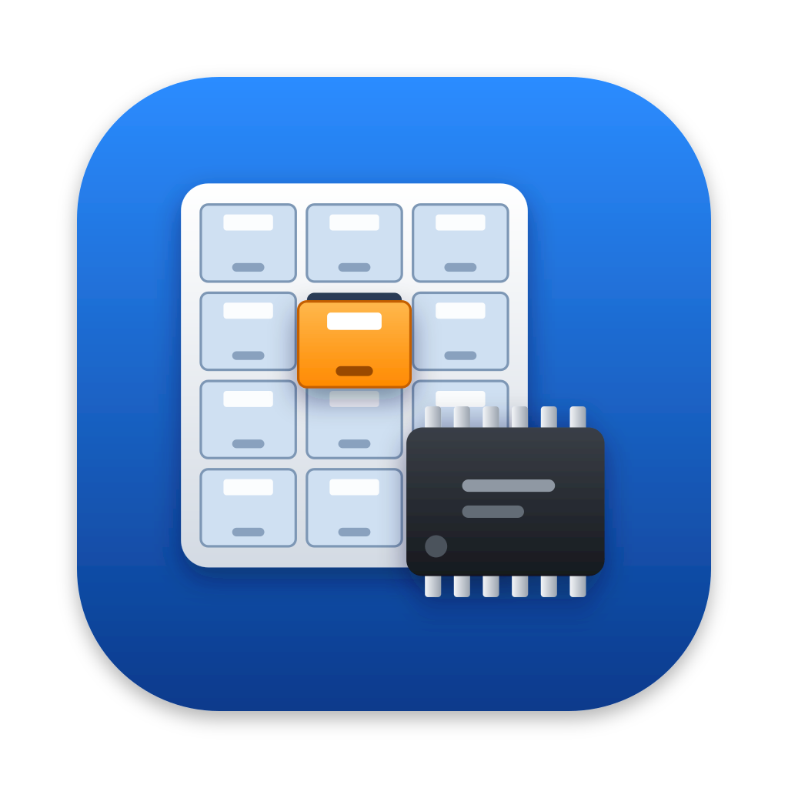
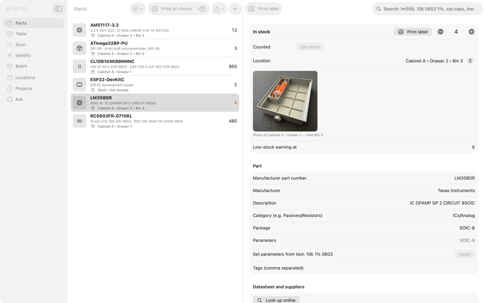
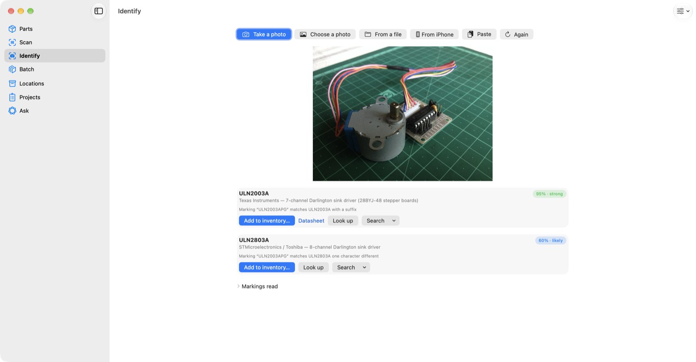
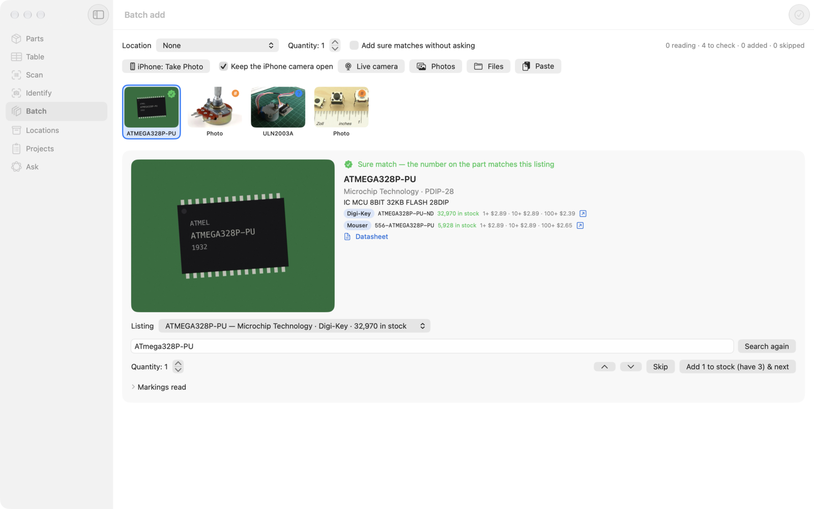
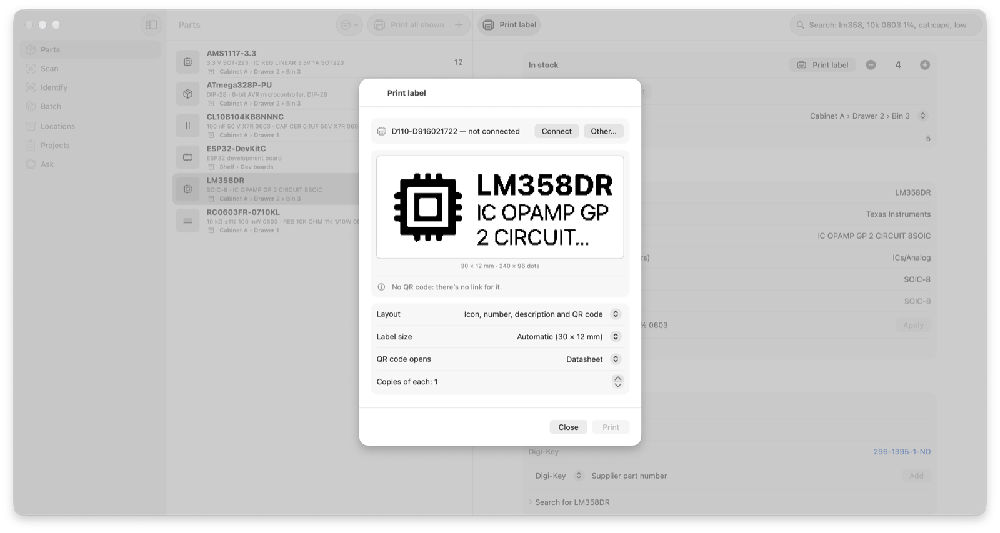
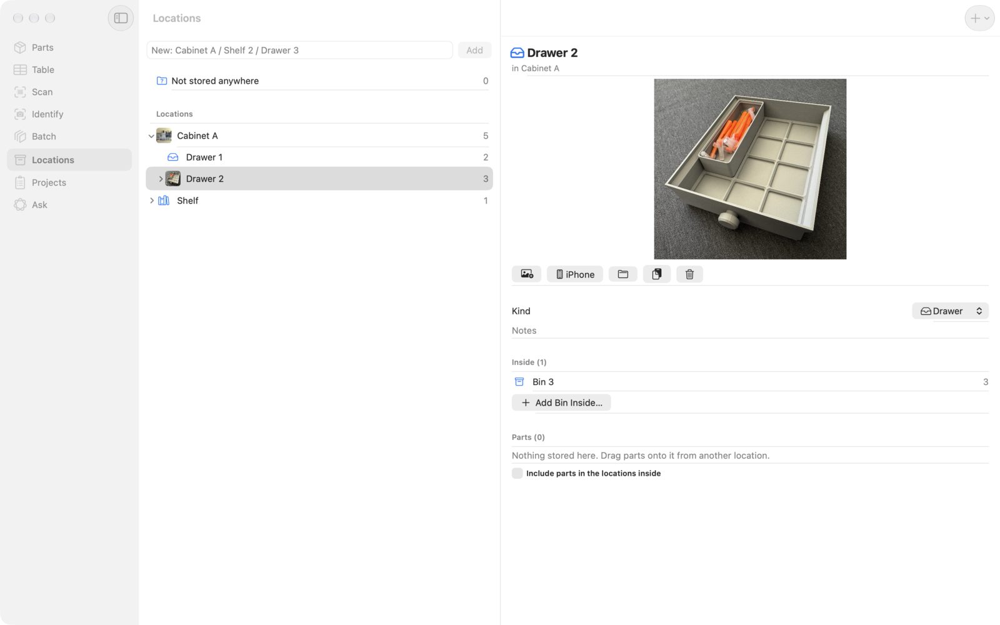
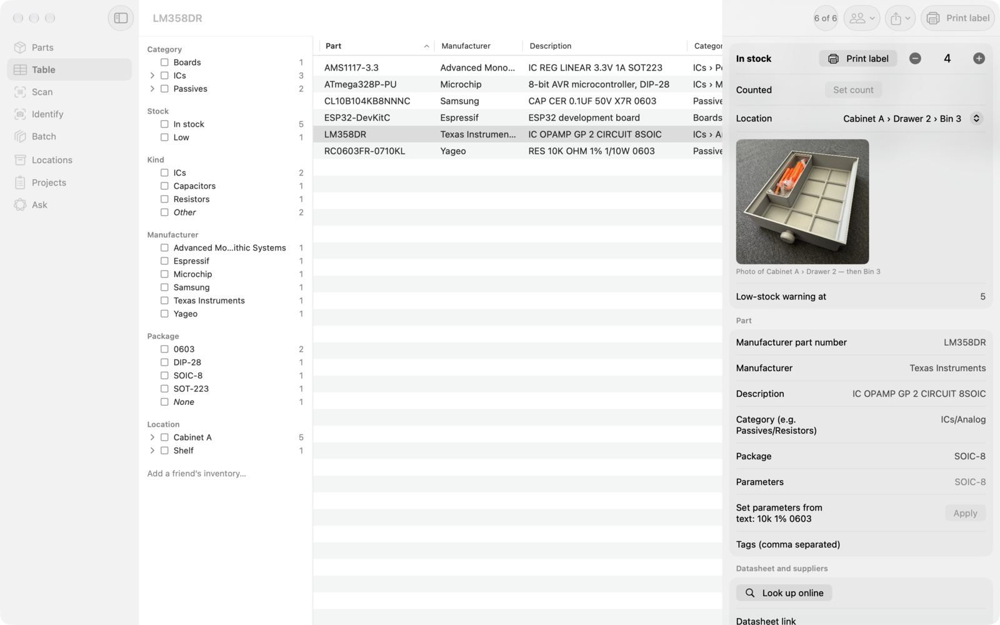

# e-Parts Inventory Manager for iPhone, iPad and Mac



**[User guide](docs/user-guide.md)** — how to use the app, with screenshots.

A native SwiftUI version of the [parts inventory](https://geekychris.github.io/tools/parts-inventory/)
web tool: keep track of electronic components, scan supplier bag labels, and identify a part from a
photo — by the markings printed on it or, when there are none, by how it looks. The data is stored
with SwiftData and synced through your private iCloud database.

| | |
|---|---|
|  |  |
| **Parts** — search, stock, locations, suppliers and a label for each part | **Identify** — the markings on a photo matched to a part |
|  |  |
| **Batch** — photo after photo, Return to add each and go on | **Labels** — NIIMBOT labels sized from what the printer reports |
|  |  |
| **Locations** — cabinets, shelves and drawers with photos; drag parts between them | **Table** — facets to drill down, friends' inventories beside yours |

## What it does

- **Parts** — a searchable inventory with the web tool's parametric search (`10k 0603 1%`,
  `100n 16V`, `cat:caps`, `loc:drawer`, `low`), stock changes with history, locations, suppliers,
  datasheets and photos.
- **Table** — every part in a sortable table (Mac and iPad; a list on iPhone) with facets beside it:
  category and location as trees, manufacturer, package, kind, stock (in stock, low, out) and tags, each
  with counts, plus the same parametric search. Values in a facet OR together, facets AND; choices show
  as removable chips. Your friends' inventories can sit beside yours (below).
- **Friends' inventories** — a friend's published inventory (a GitHub repository with `inventory.json`)
  shows in the Table beside yours, read-only, with a *Copy request* to ask to borrow some.
- **Import Order** — a whole Digi-Key, Mouser or LCSC order at once, from the CSV or Excel file their
  order history downloads (or the order's table copied from their website). Each line shows whether it
  adds to a part you have or makes a new one. The ticked lines go into stock with the order number in the
  history, the price paid and the supplier's part number. New parts can be filled in from the supplier APIs.
- **Scan** — Digi-Key, Mouser (ECIA format 06 Data Matrix) and LCSC (QR) bag labels, live with the
  camera, from a photo, or typed in by a USB scanner. A bag adds stock to the matching part or makes
  a new one.
- **Cameras** — any connected camera, on every device: the Mac's own, a USB webcam or microscope,
  Continuity Camera (an iPhone) and Desk View; the iPhone's back and front cameras; a USB-C camera on an
  iPad. Pick one above the picture (or in Settings); the choice is remembered, and cameras plugged in or
  unplugged are picked up straight away.
- **iPhone camera handoff (Mac)** — *From iPhone* (in Identify and beside the live camera, or File ›
  Import From Device) uses Continuity Camera's Take Photo: the iPhone's own camera opens on the phone,
  with zoom, macro and tap to focus, and the photo goes straight to Identify. Best for tiny markings —
  a Mac app can show the iPhone's live picture but can't zoom it.
- **Identify** — a photo of any part:
  1. barcodes (a bag label goes straight to receiving);
  2. the markings, read with Vision OCR (tried at four rotations when upright reads nothing useful)
     and matched against a built-in list of ~160 hobby parts and your own inventory, allowing for
     OCR look-alikes (O/0, I/1, S/5…), suffixes and split words;
  3. when the markings aren't enough, **how it looks**: Apple's MobileCLIP-S2 on the Neural
     Engine, in two steps — which of ~45 kinds of part (pot, relay, stepper, push button…), then,
     only as far as it looks like a board, which board;
  4. **Apple Intelligence** (the on-device Foundation Models) reads the OCR text into a part number,
     maker, description, category and package. Its reading is only trusted when its part number is
     actually in the text.
  Unknown numbers get search links (Octopart, Digi-Key, Mouser, LCSC, eBay, AllDatasheet).
- **Batch add** — for adding many parts: keep taking photos (*iPhone: Take Photo* / ⌘T on a Mac — with
  *Keep the iPhone camera open* the phone's camera opens again after each photo — the live camera, or a
  pile of photos or files). Each is read, identified and looked up at Digi-Key and Mouser while you carry
  on; Return (*Add & next*) adds it with both suppliers' numbers, prices and stock, the datasheet, package,
  parameters and the photo (or adds to the stock of a part you already have), ⌘⌫ skips, ⌘↑/⌘↓ move. When the
  queue is done, the photo source opens again. *Add sure matches without asking* adds a photo straight away
  when the number read on the part matches exactly one listing. In Identify, *Add and take another* (⌘Return)
  does the same for one part at a time. (`partlookup --read "<markings>" <number>` shows the batch decision.)
- **Part number lookup** — *Look up online* on a part, on an Identify result, or while adding a part
  asks Digi-Key's and Mouser's APIs at once: manufacturer, description, stock, price breaks, datasheet,
  package and parameters. *Fill in from this* fills only the empty fields and adds the supplier's part
  number with its prices. Needs free keys (below), kept in the Keychain.
- **Label printing** — part labels on NIIMBOT printers over Bluetooth, on the Mac, iPhone and iPad:
  the small ones (D11, D110, D101, H1…: 12–15 mm labels) and the wide ones (B1, B21, B3S…: up to
  50 mm). The app asks the printer what it is (model, print head, darkness range), what's loaded (the
  roll's RFID tag: label type and labels left; on newer printers the label size) and lays the label out
  to suit — one or two lines on a 12 mm label, an icon, a QR code and three or four lines on 40 × 30 mm.
  Three layouts: description only, icon + number + description, and the same with a QR code. The QR
  code opens the datasheet (or a supplier's page), or a public inventory page from an address template
  (`https://…/parts/{uid}/`, also {mpn}, {manufacturer}, {category}) for when the inventory is
  published; more targets are one more `LabelLinkProvider`. *Print label* on a part, *Print labels for
  these parts* on the list, and optionally a label for every part added.
- **Ask** — questions about your inventory in plain words ("do I have a 3.3 V regulator?"),
  answered by Apple Intelligence using the app's own search as a tool. Nothing leaves the device.
- **Projects** — BOMs imported in the web tool, shown against stock (how many boards you can build).
- **Backups** — import and export the web tool's JSON backup (`gw-parts-inventory` v1), so you can
  move between the two. Import merges by id; the newer copy of each item wins.
- **Export and share** — CSV and Excel files, and a folder for a GitHub repository (below).
- **API and MCP** — other programs can use the inventory while the app runs: a REST API and an MCP
  server for Claude Code and other assistants (below).

## Locations

Cabinets, shelves, drawers, bins and boxes, nested as deep as you like. **+** in the toolbar adds one
inside the selected location or at the top level, and can make a run at once (Drawer 1 to Drawer 12).
Typing `Cabinet A / Shelf 2 / Drawer 3` makes every level that's missing, and works out each kind from its name.

- **Drag a part** from a location's list onto another location in the tree to move it there. Select
  several parts first to move them together. Dropping parts on **Not stored anywhere** clears their location.
- **Drag a location** onto another one to move it with everything inside it. A location can't be moved
  into itself or into anything inside it.
- **Move To** in the right-click menu (or a long press on iPhone and iPad) does the same without dragging.
- **Photos:** give a cabinet, shelf or drawer a photo so it's easy to see where to go. Choose one from
  Photos or a file, take one with your iPhone (from the Mac) or the camera (on iPhone and iPad), paste one,
  or drop one on the location's page. A part's page shows the photo under its location. A bin without a
  photo shows its drawer's or cabinet's. Location photos go in backups that include photos
  (as photos with a `locationId`). They aren't put in a shared repository.
- A location's page sets its kind and notes. It also lists what's inside, and can show the parts in the
  locations below as well.

The kind is saved in backups as `kind` on each location. The web tool ignores it.

## Table

The **Table** section lists every part with columns for part number, manufacturer, description, category,
value, package, quantity, location, last change and — with friends' inventories shown — whose it is. Click
a heading to sort; drag to reorder or resize, and right-click a heading to hide columns (remembered).

The facets on the left narrow it down. Each value shows how many parts it would show given everything
else chosen; ticking several values in one facet shows any of them, and facets combine. Category and
location are trees: ticking *Passives* includes *Passives › Resistors* and everything else below it. The
chosen values sit above the table as chips — click one to remove it, or *Clear all*. The search field takes
the same queries as Parts (`10k 0603 1%`, `cat:caps`, `loc:drawer`, `low`) and works together with the facets.

Selecting one of your parts opens its page beside the table, editable as in Parts. On iPhone the table is
a list, with the facets under the filter button.

## Friends' inventories

Settings › **Friends' inventories** (or *Friends…* in the Table's Source facet) › *Add a friend…*: a name
and either

- a web address — `https://github.com/sam/parts` (the repository's default branch), a folder in a repository
  (`https://github.com/sam/stuff/tree/main/parts`), a link to the file itself (`…/blob/main/inventory.json`
  or a `raw.githubusercontent.com` link), or any other web address of a folder or `.json` file; or
- a folder on this device holding `inventory.json` (say a clone of their repository).

The repository needs `inventory.json` at its root (or in the folder named): the same backup file as
*Export a backup*, which the inventory repository export writes. It must be public — the app doesn't sign
in to GitHub.

Their parts then appear in the Table with a Source facet (*Mine*, *Sam*, …) to show one or several
inventories. A friend's part opens read-only: what it is, how many they have and where, datasheet and
supplier links, and *Copy request*, which copies "Could I borrow 2 × LM358DR (…)? Your inventory has it
in …" to paste into a message. Nothing of theirs is ever changed or copied into your inventory.

The last copy fetched is kept (Application Support/Friends), so the Table works offline. It's fetched again
when the Table opens and the copy is more than an hour old, or with *Refresh*. Settings shows when each was
last updated, or what went wrong (not found — check the address and that the repository is public; not an
inventory file; no connection).

## Export and share

The **Export** menu (on the Parts toolbar; on the Mac also in the File menu):

- **Export as CSV…** / **Export as Excel…** — every part (or, from a table, the parts it shows): MPN,
  manufacturer, description, category, value, package, quantity, low-stock level, location, datasheet,
  supplier part numbers, tags, notes and the date updated. The CSV is UTF-8 with a byte-order mark and
  CRLF line ends, so Excel reads "Ω" and "±" correctly; the Excel file has a bold, frozen header row with
  a filter, and numbers as numbers.
- **Export to folder…** — the whole inventory as a folder for a git repository: a `README.md` with the
  totals, the category tree and what's running low, a page per category, `parts.csv`, and
  `inventory.json` for the app to read. On GitHub it reads as a browsable catalogue. The app remembers
  the folder: **Export to "…" again** brings it up to date, changing only the files that differ and
  removing pages that no longer apply; everything else in the folder (`.git`, a licence) is left alone.

To share it on GitHub, export into a clone of a repository and push (the app doesn't run git itself):

```sh
git clone https://github.com/you/parts.git ~/parts      # once; then Export to folder… → ~/parts
cd ~/parts && git add -A && git commit -m "Inventory" && git push
```

Settings › Export and share sets the inventory's name and whether to include projects and stock history
(off by default — sharing is parts and locations only, without the prices you paid) and photos. **Import from folder…** reads such a
folder's `inventory.json` and merges it the way importing a backup does. The format is in
[docs/repository-format.md](docs/repository-format.md).

## API and MCP

Settings › **API & MCP** › *Enable API and MCP server* (off until you turn it on). The app then serves
`http://127.0.0.1:8765` — this Mac only, unless *Allow other devices on my network* is on. Every request
needs the token shown there (made once, kept in the Keychain, *Make a new token* to replace it):
`Authorization: Bearer <token>`. Requests from web pages on other sites are refused (Origin check).
On iPhone and iPad it answers only while the app is open.

**Claude Code** — copy the command from Settings, or:

```sh
claude mcp add --transport http parts-inventory http://127.0.0.1:8765/mcp \
  --header "Authorization: Bearer <token>"
```

Tools: `search_parts` (the same search as the app: "10k 0603 1%", "cat:caps", "loc:drawer 2", "low"),
`get_part`, `add_part` (with `lookup` to fill in from Digi-Key and Mouser), `update_part`, `adjust_stock`,
`set_stock`, `delete_part` (needs `confirm`), `list_locations`, `add_location`, `list_projects`,
`get_project`, `supplier_lookup`, `identify_photo` (base64 photo) and `low_stock`. The endpoint speaks
MCP's Streamable HTTP transport with JSON responses (protocol 2025-11-25, 2025-06-18 and 2025-03-26).

**REST** — JSON under `/api`, described by `/api/openapi.json`. Parts look like the backup file's parts
(ids are the same), plus `locationPath`, `photoCount`, `isLow` and `summary`.

| | |
|---|---|
| `GET /api/health` | up? (no token needed) |
| `GET /api/parts?q=&category=&location=&low=true&limit=&offset=` | search |
| `POST /api/parts` | add (`{"mpn": …, "qty": 5, "location": "Cabinet A / Drawer 3", "lookup": true}`) |
| `GET` · `PATCH` · `DELETE /api/parts/{id}` | one part (GET includes recent stock history) |
| `POST /api/parts/{id}/stock` | `{"delta": -2, "note": "…"}` or `{"set": 40}` — recorded in its history |
| `GET /api/parts/{id}/photos/{n}` | a photo |
| `GET` · `POST /api/locations` | locations; `{"path": "Shelf / Box 2"}` makes one |
| `GET /api/projects`, `GET /api/projects/{id}` | BOMs with need, have and the matched part |
| `GET /api/lookup?q=LM358DR` | Digi-Key and Mouser listings |
| `POST /api/identify` | a photo (raw image, form upload, or `{"image": "<base64>"}`) → markings and candidates |
| `GET /api/export`, `POST /api/import` | the backup file both ways (`?photos=true` to include photos) |

```sh
T=<token>
curl -H "Authorization: Bearer $T" "http://127.0.0.1:8765/api/parts?q=10k%200603"
curl -H "Authorization: Bearer $T" -H "Content-Type: application/json" \
  -d '{"mpn":"NE555P","qty":10,"location":"Cabinet A / Drawer 2","lookup":true}' http://127.0.0.1:8765/api/parts
curl -H "Authorization: Bearer $T" -H "Content-Type: application/json" \
  -d '{"delta":-2,"note":"timer kit"}' http://127.0.0.1:8765/api/parts/<id>/stock
curl -H "Authorization: Bearer $T" --data-binary @chip.jpg -H "Content-Type: image/jpeg" http://127.0.0.1:8765/api/identify
```

Changes made through the API are the same as changes made in the app: stock changes go into the part's
history ("API — <note>"), and everything syncs through iCloud like any other edit.

## Building

Requires Xcode 26 (iOS, iPadOS and macOS 26), [XcodeGen](https://github.com/yonaskolb/XcodeGen) and
[uv](https://docs.astral.sh/uv/).

```sh
uv run tools/make-clip-embeddings.py --download-dir /tmp/mobileclip   # fetches the look model (~68 MB, not in git)
xcodegen generate
open PartsInventory.xcodeproj
```

Without the model the app still builds; recognising by look is then switched off.

**iCloud.** The app uses the container `iCloud.com.hitorro.PartsInventory` (team T2M6R36LYY).
Build once from Xcode with your team selected so it registers the container and the iCloud
capability. An unsigned build (no iCloud entitlement) keeps its data on the device instead — the app
checks its own entitlements, because CloudKit stops the app rather than reporting an error.

**Supplier keys.** Both are free; add them in Settings › Supplier lookups.

- *Digi-Key* — sign in at [developer.digikey.com](https://developer.digikey.com), create an organisation,
  then a **production** app subscribed to **Product Information V4** (any callback URL, e.g.
  `https://localhost`). Copy its client ID and secret. The app uses the 2-legged (client credentials)
  sign-in, so no browser login is needed. About 1,000 lookups a day.
- *Mouser* — sign in to mouser.com, open [API Hub](https://www.mouser.com/api-hub/) › **Search API**
  and register; the key arrives at once (My Account › APIs). 30 lookups a minute, 1,000 a day.

Try the keys from a terminal without the app:

```sh
cd PartsKit
DIGIKEY_CLIENT_ID=… DIGIKEY_CLIENT_SECRET=… MOUSER_API_KEY=… swift run partlookup LM358DR
```

**Label printer.** Settings › Label printer › *Connect…* finds printers nearby (the printer can't be
connected to the NIIMBOT app at the same time); the app reconnects to the same one later. If the
printer doesn't report its label size, choose it there. From a terminal, without printing:

```sh
cd PartsKit
swift run niimbot           # printers nearby
swift run niimbot --info    # connect to one and show model, print head, darkness, roll
```

The terminal app needs Bluetooth permission the first time (macOS asks).

## Tests

```sh
cd PartsKit && swift test          # the parsers and matching — the same cases as the web tool's tests
TEST_RUNNER_TEST_PHOTOS_DIR=/path/to/photos \
  xcodebuild test -project PartsInventory.xcodeproj -scheme PartsInventory \
  -destination 'platform=macOS,arch=arm64' CODE_SIGNING_ALLOWED=NO
```

The second runs the real pipeline (Vision, MobileCLIP, Apple Intelligence) on `chip.jpg`, `pot.jpg`,
`stepper.jpg` and `tact.jpg` in that folder.

Debug builds accept `-demo` (sample parts), `-memoryStore` (an in-memory store, leaving the real inventory alone — and
the friends list), `-tab identify` and `-identify <path>` at launch, `-friend "Sam=<address or /folder>"` (a friend
for that run), `-tableFilter "category=Passives;source=Sam"`, `-tableSearch <q>`, `-tableSelect <part number>`,
`-tableFriends`, `-importFrom <folder>` and `-exportTo <folder>` (Import from folder…, then the repository, CSV and
Excel exports, without a window), and
`-apiServer` (start the API and MCP server for this run), `-apiToken <t>` and `-apiPort <n>`. The app's
tests run against an in-memory store, never the real inventory; `APITests` drive the REST API and MCP
over HTTP.

## Layout

- `PartsKit/` — a Swift package with no UI: engineering values and packages, the search, bag-label
  parsing, the built-in catalog (`Resources/catalog.json`, shared with the web tool via
  `tools/export-catalog.sh`), marking matching and ranking, look scoring, the backup format, and the
  Digi-Key and Mouser clients (`SupplierAPI.swift`, with the `partlookup` command), NIIMBOT
  printing: the protocol, models and print jobs (`Niimbot.swift`), Bluetooth (`NiimbotBluetooth.swift`,
  with the `niimbot` command) and label layout and QR targets (`LabelLayout.swift`), the table's rows,
  facets and counts (`InventoryRow.swift`, `Facets.swift`), friends' inventory addresses and fetching
  (`RemoteInventory.swift`), the exports: CSV, Excel (a small ZIP writer) and the repository folder with its
  Markdown pages (`Export/`), and the HTTP server, request checks and MCP endpoint behind the API (`Server/`).
- `App/` — the SwiftUI app: SwiftData models (`Model/`), Vision and Core ML (`Vision/`), Foundation
  Models (`Intelligence/`), label rendering and the printer screens (`Labels/`), the REST routes and MCP
  tools (`API/`), friends' inventories — the list, fetching and cache, and their screens (`Friends/`) — and
  the other screens (`Views/`, the table in `InventoryTableView.swift`, `InventoryTableModel.swift` and
  `FacetColumn.swift`).
- `tools/` — `make-clip-embeddings.py` (text embeddings for the look labels, and the image encoder)
  and `export-catalog.sh`.

## Licences

The app's code is under the [MIT licence](LICENSE).

The photos in the screenshots are from Wikimedia Commons:
[28BYJ-48 stepper motor with ULN2003 driver](https://commons.wikimedia.org/wiki/File:28BYJ-48_unipolar_stepper_motor_with_ULN2003_driver.jpg)
by Kushagra Keshari (CC BY-SA 4.0),
[Potentiometer](https://commons.wikimedia.org/wiki/File:Potentiometer.jpg) by Iainf (CC BY 2.5) and
[Tactile switches](https://commons.wikimedia.org/wiki/File:Tactile_switches.jpg) by Scwerllguy (CC BY-SA 3.0).
The chip photo is a rendering made for the tests.

The look model is Apple's **MobileCLIP-S2** image encoder, from the Core ML conversions at
[apple/coreml-mobileclip](https://huggingface.co/apple/coreml-mobileclip) (revision 3e0a7bf,
2024-11-19), with text embeddings computed from its matching text encoder. That repository states the
Apple Sample Code License, which allows redistribution in binary form. Apple's MobileCLIP GitHub
repository has since moved its weights to the Apple Machine Learning Research Model License, which
allows non-commercial research only. Personal use is fine either way; before selling the app or putting
it on the App Store, check the terms or switch to a model with a clear commercial licence. The model
isn't stored in this repository.

The NIIMBOT protocol is ported from [NiimBlue's niimbluelib](https://github.com/MultiMote/niimbluelib)
(MIT, © 2024 MultiMote): packet format, commands and replies, printer models and the print sequence for
each model family.
