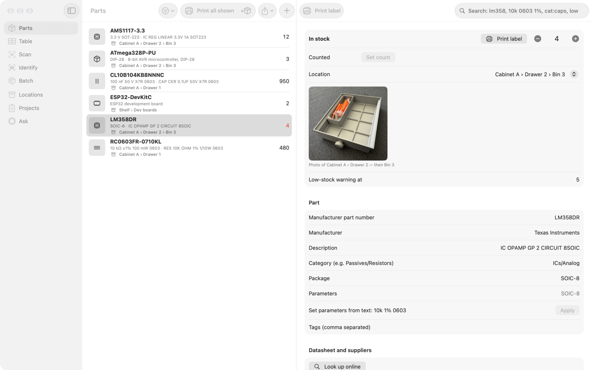
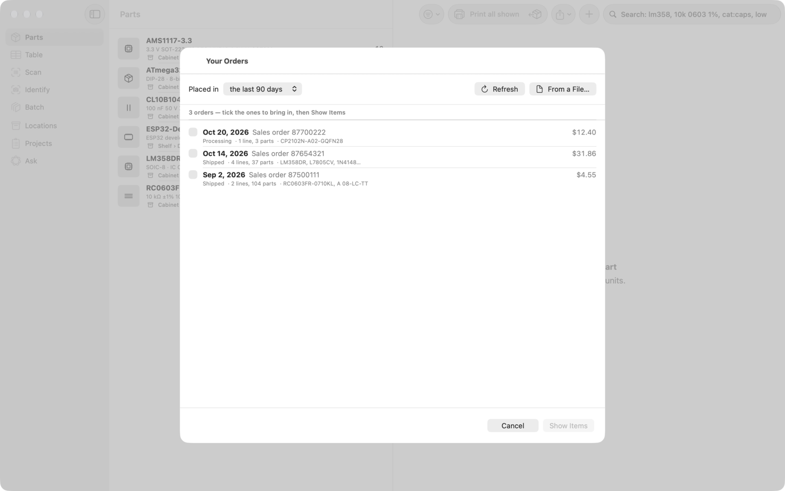
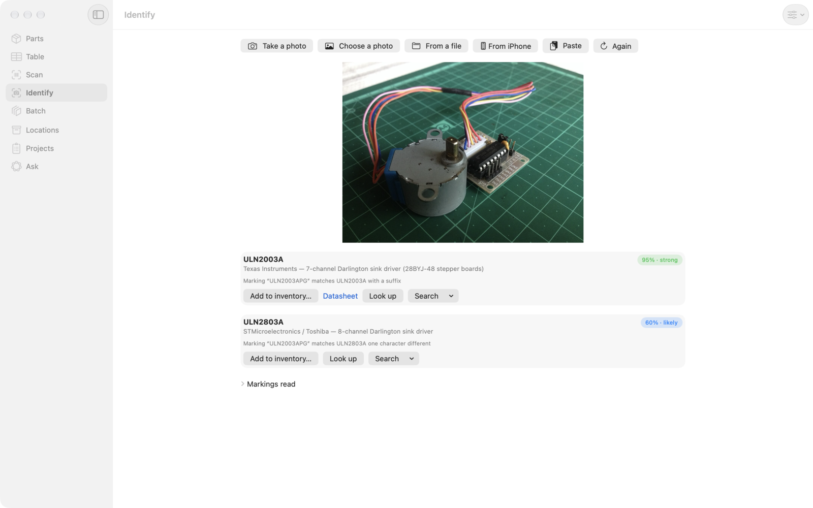
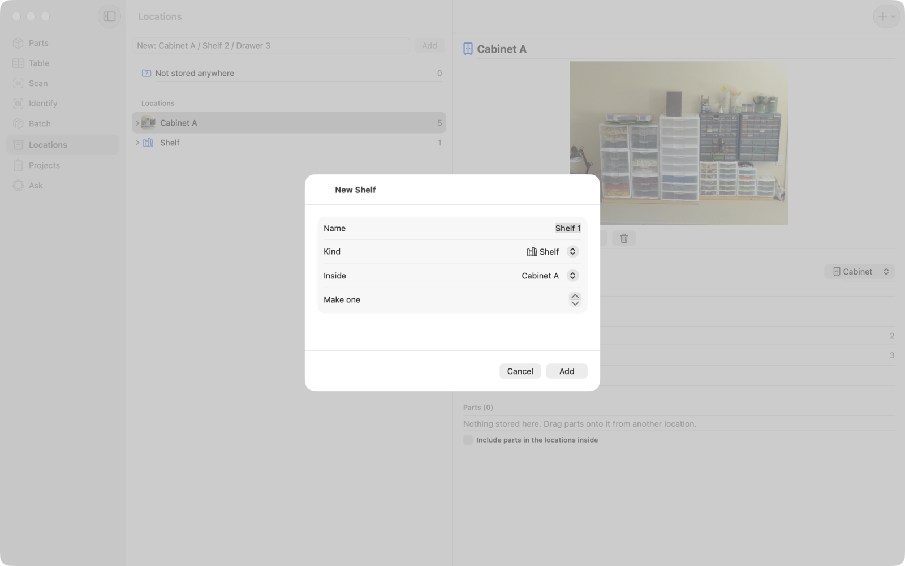
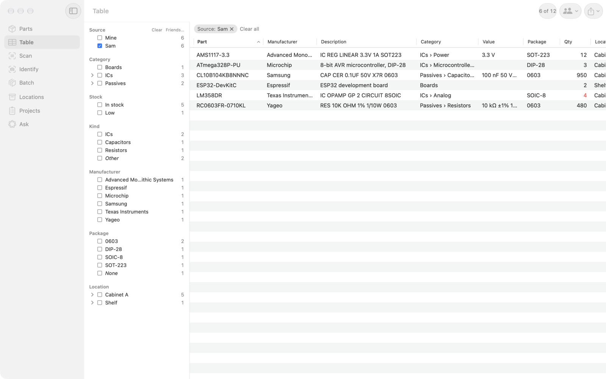
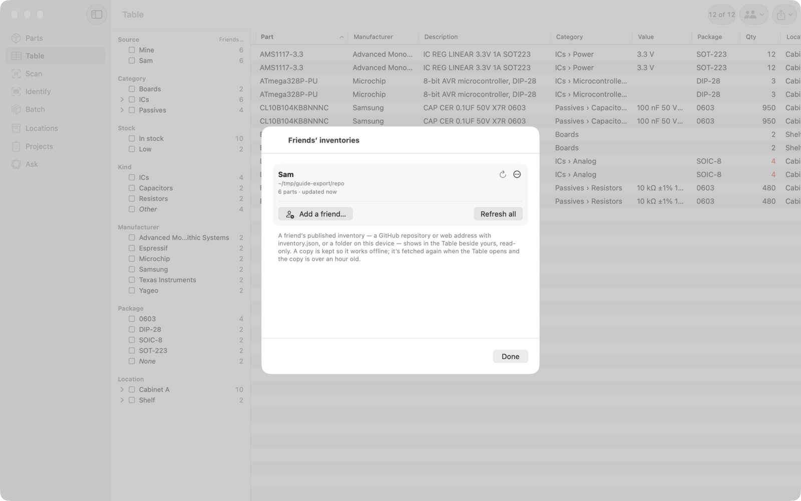

# e-Parts Inventory Manager — user guide


e-Parts Inventory Manager keeps track of your electronic parts:
- what you have and how many;
- where each part is: which cabinet, shelf, drawer or bin, with a photo so you can find it;
- what each part is, worked out from a photo of its markings or a supplier's bag label.

It runs on the Mac, iPhone and iPad. Your inventory syncs between them through your own iCloud account.

This guide covers everyday use. The [README](../README.md) has the technical details: building, the
API and MCP server, and the file formats.

- [The window](#the-window)
- [Parts](#parts)
- [Adding parts](#adding-parts)
- [Locations: cabinets, shelves, drawers and bins](#locations)
- [The Table and its filters](#the-table)
- [Friends' inventories](#friends-inventories)
- [Labels](#labels)
- [Export, backup and sharing](#export-backup-and-sharing)
- [Ask](#ask)
- [Settings](#settings)
- [Tips](#tips)

---

## The window

The sidebar on the left switches between the app's sections:

| Section | For |
|---|---|
| **Parts** | Your inventory as a list, with a part's page beside it |
| **Table** | Every part in a sortable table with filters, yours and your friends' |
| **Scan** | Scanning supplier bag labels (Digi-Key, Mouser, LCSC) |
| **Identify** | Working out what a part is from a photo |
| **Batch** | Adding many parts quickly, photo after photo |
| **Locations** | Your cabinets, shelves, drawers and bins, and what's in each |
| **Projects** | Bills of materials, checked against your stock |
| **Ask** | Questions about your inventory in plain words |

On iPhone the sections are tabs along the bottom. On iPad and the Mac they're in the sidebar.

---

## Parts



The list shows every part with its part number, a short description, where it is and how many you have.
A number in red means the part is running low.

### Searching

The search field understands electronics, not just words:

| Type | Finds |
|---|---|
| `lm358` | any part with that in its number, maker, description or notes |
| `10k 0603 1%` | 10 kΩ resistors in 0603 with 1 % tolerance |
| `100n 16V` | 100 nF capacitors rated 16 V or more |
| `cat:caps` | everything in a category |
| `loc:drawer 2` | everything in a location |
| `mfr:ti` | parts by a maker |
| `tag:smd` | parts with a tag |
| `low` | parts at or below their low-stock level |

These combine: `cat:caps 0603 low` finds 0603 capacitors that are running low.

### A part's page

Select a part to open its page:

- **In stock**: **−** and **+** use or add one at a time. **Counted** sets the number after a stock-take.
  Every change goes in the part's history.
- **Location**: where it's kept. If that location, or the drawer or cabinet it's in, has a photo,
  the photo shows here. When you go to fetch the part, you can see which drawer to open.
- **Low-stock warning at**: the count at which the part is shown as running low.
- **Part**: part number, maker, description, category (`Passives/Resistors`), package and tags.
  **Set parameters from text** reads values like `10k 1% 0603` into the part's parameters.
- **Datasheet and suppliers**: **Look up online** asks Digi-Key and Mouser about the part number.
  It shows their description, stock, prices, datasheet and parameters. **Fill in from this** copies
  them into the empty fields.
- **Photos**: pictures of the part itself.
- **Print label** prints a label for the part's bag or bin (see [Labels](#labels)).

---

## Adding parts

There are five ways in, depending on what you have in your hand.

### A whole order: Import Order


When a Digi-Key, Mouser or LCSC order arrives, you can add everything in it at once instead of scanning
each bag.

**1. Get the order.** There are two ways.

**Straight from Digi-Key or Mouser.** Import Order can list your orders itself once you've added two things
in Settings › **Supplier lookups**:
- **Digi-Key account number.** It's on any invoice, or under My Account on digikey.com. On
  [developer.digikey.com](https://developer.digikey.com), your app must also be subscribed to
  **Order Status** as well as Product Information. The client ID and secret you already use for lookups
  then read your orders. There's nothing else to sign in to.
- **Mouser Order History API key.** Request it at [mouser.com/api-hub](https://www.mouser.com/api-hub/).
  It's a different key from the Search API one.

**Save and test** checks that both work. Import Order then opens on **Your Orders**:
- Choose Digi-Key or Mouser, and for Digi-Key how far back to look.



- Orders you've imported before are marked **Imported**.
- Tick one or more orders, then click **Show Items**.

**Or from a downloaded file:**
- **Digi-Key:** sign in › Order History › open the order › **Download**.
- **Mouser:** sign in › Order History › open the order › **Export**.
- **LCSC:** Orders › the order › **Export**.

CSV and Excel files both work. You can also select the table of parts on the order's web page, copy it,
and paste it in.

**2. Open Import Order:** the **Import order** button on the Parts toolbar (a box with an arrow, beside
**Print all shown**), or File › **Import Supplier Order…**
(⇧⌘O). If Digi-Key or Mouser is set up, it opens on **Your Orders**. Otherwise, or after clicking
**From a File…**, choose the file, drop it on the window, or click **Paste**.

**3. Check the lines.** While you look, the app looks up each item at Digi-Key and Mouser to show its full
description, package and a datasheet link. Each line shows what will happen:
- **Adds to …** — a part you already have, matched by the supplier's part number or the maker's
  number. The app shows how many you have now and where they are.
- **New part** — a new part will be made.

Untick any line you don't want. You can also choose where the new parts go, and whether to fill them in
from Digi-Key and Mouser (datasheet, package, parameters).

**4. Click Add to Stock.** Each part:
- gets the quantity added, with "Order — Digi-Key order 87654321" in its stock history;
- gets the price you paid;
- gets the supplier's part number. **Look up online** and the bag labels then find it by that number.

Without the account number or the Order History key, download the order file instead.

### From a supplier's bag: Scan

Point the camera at the label on a Digi-Key, Mouser or LCSC bag. The code on the label already
holds the part number, quantity and supplier, so there's nothing to type. If you already have
the part, its stock goes up; if not, a new part is made. A USB barcode scanner works too: scan into the
field at the bottom.

### From the part itself: Identify



Take or choose a photo of the part. The app reads the markings printed on it and matches them against
known parts and your own inventory. If there are no markings, it goes by what the part looks like
(a potentiometer, a relay, a push button…). Each suggestion shows how sure the app is:
- **Add to inventory…** adds it.
- **Look up** asks Digi-Key and Mouser.
- **Search** opens the part number on supplier and datasheet sites.

There are several ways to get the photo in:

| Button | Photo source |
|---|---|
| **Take a photo** | The live camera |
| **Choose a photo** | Your photo library |
| **From a file** | An image file |
| **From iPhone** (Mac only) | Your iPhone's camera, with zoom, macro and focus — the best way to read tiny markings |
| **Paste** | The clipboard |

### Many at once: Batch


Batch is for clearing a pile of parts:
1. Keep taking photos (**iPhone: Take Photo**, ⌘T on the Mac) or drop in a folder of pictures.
2. Each photo is read and looked up in the background while you carry on.
3. Check each result, then press **Return** to add it and move to the next. **⌘⌫** skips one.

Two settings make it faster:
- **Location** and **Quantity** at the top apply to everything you add.
- **Add sure matches without asking** adds a part straight away when the number read off it matches
  exactly one supplier listing.

### By hand

**+** on the Parts toolbar adds an empty part to fill in.

---

## Locations


Locations are where you keep things:
- They nest as deep as you need, for example *Cabinet A › Shelf 2 › Drawer 3 › Bin 4*.
- Each location has a kind: **cabinet**, **shelf**, **drawer**, **bin**, **box** or **other**.
- The number beside a location counts the parts in it and in everything inside it.

### Making locations



- **The + button** (top right) adds a location. It goes inside the selected one, or at the top level
  for a new cabinet. Choose its name, kind and where it goes. **Make** creates a numbered run in one
  go: name it *Drawer 1*, set Make to 12, and you get Drawer 1 to Drawer 12.
- **The field at the top** takes a whole path at once. Type `Cabinet B / Shelf 1 / Drawer 3` and press
  Return, and every level that doesn't exist yet is made. The kind of each level comes from its name.
- **Add … Inside** on a location's page, or **Add Inside** in its right-click menu, adds a location
  inside that one.

A new location is selected, and the tree opens to show it.

### Moving things around

- **Drag a part** from a location's list onto any location in the tree to move it there. To move several,
  select them first (⌘-click or Shift-click), then drag any one of them.
- **Drag a location** (a shelf, say) onto another location (another cabinet). It moves with everything in it.
- **Not stored anywhere** at the top of the tree lists parts without a location. Drag them into place
  from there. Dropping a part on it clears its location.
- **Move To** in the right-click menu does the same without dragging. On iPhone and iPad, touch and hold
  for the menu.

A location can't be moved into itself or into anything inside it. The app won't let you drop it there.

### Photos of locations

A photo of each cabinet, shelf or drawer makes it easy to find a part again, for you or anyone you've
asked to fetch something. On a location's page:

| Button | Photo source |
|---|---|
| **Photos…** | Your photo library |
| **iPhone** (Mac only) | Your iPhone's camera |
| **Take Photo** (iPhone and iPad) | The device's camera |
| **File…** | An image file |
| **Paste** | The clipboard |

You can also drag an image file onto the photo area. Click the photo to see it larger. The bin icon
removes it.

A location without its own photo shows the nearest one above it. A bin with no photo shows its
drawer's, or failing that, its cabinet's. The photo also appears on every part's page under
**Location**, as in the Parts picture above.

### A location's page

A location's page also has:
- its **kind**, which you can change at any time;
- **notes**, for example "left of the bench, second from the top";
- the locations **inside** it;
- its **parts**. Turn on **Include parts in the locations inside** to see everything below it in one list.

---

## The Table


The Table shows every part in columns: part number, maker, description, category, value, package,
quantity, location and when it last changed.
- **Sort**: click a column heading.
- **Rearrange**: drag a heading to move or resize its column. Right-click a heading to hide or show columns.
- **Open a part**: select it and its page opens on the right, the same page as in Parts.

**Filters (facets)** on the left narrow the list down:

| Facet | Values |
|---|---|
| **Category** | a tree, e.g. Passives › Resistors |
| **Stock** | in stock, low, out |
| **Kind** | ICs, capacitors, resistors… |
| **Manufacturer** | each maker |
| **Package** | 0603, SOIC-8… |
| **Location** | a tree, e.g. Cabinet A › Drawer 2 |
| **Tags** | your tags |

How filters combine:
- The number beside each value says how many parts you'd see if you ticked it.
- Values ticked in one facet add up. Ticking *0603* and *0805* shows both.
- Different facets narrow each other down. *Capacitors* plus *0603* shows only 0603 capacitors.
- Ticking a category or location includes everything below it.
- What you've chosen shows as chips above the table. Click a chip's **×** to remove it, or **Clear all**.
- The search field works as in Parts, together with the filters.

The **Export** button on the toolbar exports exactly the parts the table is showing.

---

## Friends' inventories



If a friend publishes their inventory (see [Sharing on GitHub](#sharing-on-github)), you can see their
parts next to yours. That way you can check whether they have something before you order it.



**Add a friend:**
1. In the Table, choose **Friends…** in the **Source** filter (or Settings › Friends' inventories).
2. Click **Add a friend…**.
3. Give a name and where their inventory lives. That can be a GitHub repository address such as
   `https://github.com/sam/parts`, any web address of their `inventory.json`, or a folder on your
   computer (such as a copy of their repository).

**See their parts:**
- Their parts appear in the Table, and the **Source** filter chooses whose to show: *Mine*, *Sam* or both.
- A friend's part opens read-only. It shows what it is, how many they have and where, with datasheet and
  supplier links.
- **Copy request** copies a message like "Could I borrow 2 × LM358DR? Your inventory has it in Cabinet A
  › Drawer 2" for you to paste into a chat or email.

**What the app does with their data:**
- It never changes their inventory and never copies their parts into yours.
- It keeps the last copy it fetched, so their parts still show when you're offline.
- It fetches a fresh copy when you open the Table and the old one is over an hour old. **Refresh**
  fetches one straight away.

---

## Labels


The app prints part labels on NIIMBOT Bluetooth label printers. That includes the small ones (D11, D110,
D101, H1) and the wide ones (B1, B21, B3S).

**Connect the printer:** Settings › **Label printer** › **Connect…**. The app reads the printer's model and
the labels loaded in it, and sizes the label to match.

**Print:**
- **Print label** on a part's page prints that part's label (⌘P on the Mac).
- **Print all shown** on the Parts toolbar prints labels for every part in the list. Search first to print
  just a few.
- You can also have a label printed automatically for every part you add (Settings).

**Layouts** — choose one of three:
- the description only;
- an icon, the part number and the description;
- the same plus a QR code. Scanning the code opens the part's datasheet or supplier page.

---

## Export, backup and sharing

The **Export** menu is on the Parts toolbar, and on the Mac also in the File menu.

**Spreadsheets:** **Export as CSV…** and **Export as Excel…** write every part with its details: part
number, maker, description, category, value, package, quantity, location, datasheet, supplier numbers,
tags and notes. They open cleanly in Excel, Numbers or Google Sheets, symbols like Ω and ± included.

**Backups:** Settings › Backup › **Export a backup…** saves the whole inventory as one file, and **Import a
backup…** merges one back in. Nothing is deleted on import: where a part is in both, the newer copy wins.
The file is the same format as the web version of the
[parts inventory](https://geekychris.github.io/tools/parts-inventory/), so you can move between the two.
Turn on photos to include part photos and location photos.

### Sharing on GitHub

**Export to folder…** writes your inventory as a folder for a GitHub repository:
- a **README** with your totals, the categories and what's running low;
- a **page per category** listing its parts;
- a **CSV** of everything;
- **`inventory.json`**, which other copies of the app read (this is what friends add).

To publish it, export into a copy of a repository and push it:

```sh
git clone https://github.com/you/parts.git ~/parts      # once; then Export to folder… → ~/parts
cd ~/parts && git add -A && git commit -m "Inventory" && git push
```

After the first time, **Export to "parts" again** brings the folder up to date. It changes only what's
different and leaves everything else in the folder alone.

What a shared export leaves out (Settings › Export and share):
- The prices you paid, your projects and your stock history are left out unless you turn them on.
- Photos are left out unless you turn them on.
- Location photos are never shared.

---

## Ask

Ask questions in plain words, such as "do I have a 3.3 V regulator?", "what's low on stock?" or "which
drawer are the 0603 resistors in?". Apple Intelligence answers using the app's own search. Nothing leaves
your device. Ask needs a device with Apple Intelligence turned on.

---

## Settings

On the Mac, Settings is under **e-Parts Inventory Manager › Settings…** (⌘,).

| Section | What it sets |
|---|---|
| **iCloud** | Shows whether your inventory syncs through iCloud, and the account |
| **Stock** | The default low-stock level and your currency |
| **Backup** | Import or export a backup file, with or without photos |
| **Export and share** | The shared inventory's name, and what a shared export includes |
| **Camera** | Which camera Scan, Identify and Batch use (the Mac's, a USB webcam or microscope, or an iPhone) |
| **Supplier lookups** | Free Digi-Key and Mouser API keys for **Look up online**. Also your Digi-Key account number and a Mouser Order History key, for listing your orders in Import Order. They're kept in the Keychain |
| **Friends' inventories** | Your friends' inventories |
| **API & MCP** | Lets other programs (Claude Code and other AI assistants) use your inventory while the app runs. Off until you turn it on. See the [README](../README.md#api-and-mcp) |
| **Label printer** | The NIIMBOT printer, the label layout, and whether to print a label for each new part |
| **Recognition** | How photos are identified |

---

## Tips

- **Photograph your storage once.** A photo of each cabinet and drawer, then one of each part,
  takes a few minutes. After that, every part's page shows exactly where to look.
- **Name locations as you'd say them.** "Cabinet A / Shelf 2 / Drawer 3" — the app works out which is a
  cabinet, a shelf and a drawer from the names.
- **Use Batch for a new delivery.** Set the location and quantity at the top, then take photos and
  press Return for each one.
- **Use the iPhone for small markings.** On the Mac, **From iPhone** gives you the phone's macro camera.
  It reads SOT-23 and 0603 markings that a webcam can't.
- **Check a friend before ordering.** Tick their name in the Table's Source filter and search.

---

*Photos in this guide: "Lego shelves" by Âtin, [CC BY 2.0](https://creativecommons.org/licenses/by/2.0/),
and "Gridfinity drawer and bin" by Sandstein, CC0, both from Wikimedia Commons, used as example
location photos. The stepper board in the Identify example is by Kushagra Keshari, CC BY-SA 4.0.*
